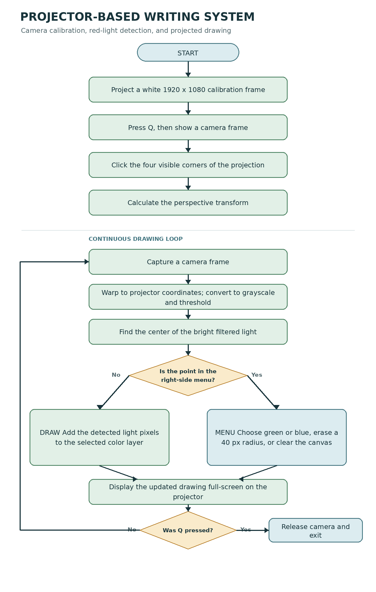

# Projector-Based Writing System

A camera-assisted writing system that turns a standard projector into an interactive whiteboard. The user draws with a red LED or laser pointer on the projected surface; a camera detects the light, and the program displays the resulting strokes through the projector.



## How It Works

1. The projector displays a white 1920 x 1080 calibration frame.
2. The operator clicks the four visible projection corners in the camera image. OpenCV calculates a perspective transform that maps the tilted camera view onto the projector canvas.
3. During operation, each camera frame is warped into projector coordinates and converted to grayscale. A brightness threshold identifies the light passing through the red filter.
4. The program finds the center of the detected light pixels and decides whether the pointer is over the drawing area or the menu on the right.
5. The drawing is updated and displayed full-screen through the projector.

The camera and projector positions must remain fixed after calibration. Recalibrate if either one moves.

## Controls

- Press `Q` on the white calibration screen to continue to the camera view.
- Click the four corners of the projected area, then press `Q` to calculate the transform and start drawing.
- Move the light pointer across the projected surface to draw.
- Use the menu strip on the right edge to choose green or blue, erase around the pointer, or clear the whole canvas. The menu actions run from top to bottom: clear, eraser, blue, green.
- Press `Q` to exit the drawing loop.

The eraser clears a circular area with a 40-pixel radius. The script writes per-frame capture, transform, frame-rate, and loop-duration measurements to `Zeiten.txt` in the current working directory.

## Hardware and Setup

- A computer capable of running the image-processing loop
- A projector connected as a display
- A webcam aimed at the entire projected area
- A red transparent filter, such as red Plexiglas, mounted in front of the camera lens
- A red LED or laser pointer used as the writing tool

Place the camera so the projection corners are visible and keep the user from blocking its view. Configure the projector as an extended display if needed, and make sure the full-screen OpenCV window appears on the projected display. Adjust the webcam index in `cv2.VideoCapture(0)` if the camera is not device 0.

The project report found that the red optical filter combined with a grayscale brightness threshold produced more reliable detection than software-only color filtering. The current script uses a fixed threshold of `180`; ambient light, the projector, and the filter may require calibration or threshold adjustment.

## Software

The current [`Projector-Based_Writing_System.py`](Projector-Based_Writing_System.py) is the single-threaded implementation. It requires Python 3, OpenCV, and NumPy. Install the Python packages with:

```bash
python3 -m pip install opencv-python numpy
```

Run the program from the project directory so that `Zeiten.txt` is created there:

```bash
python3 Projector-Based_Writing_System.py
```

The accompanying [project report](T_3200_TEL20NT_Hepp_Nils_Thomas.pdf) describes the design, calibration method, optical filter, and performance tests.

## Performance and Limitations

The report measured approximately 10 frames per second on a Raspberry Pi for its test setup and judged the interaction too slow. It therefore excluded the Raspberry Pi as the processing unit; a laptop or PC with adequate processing performance is recommended. Results depend on the camera, lighting, projector, and computer.

The report also describes a multithreading experiment, but the Python file in this project is single-threaded. That experiment did not produce a measurable speed improvement. Fast pointer movement may leave gaps in strokes when the frame rate is too low. The system can also react to bright white light, and the camera must not be moved after calibration.
